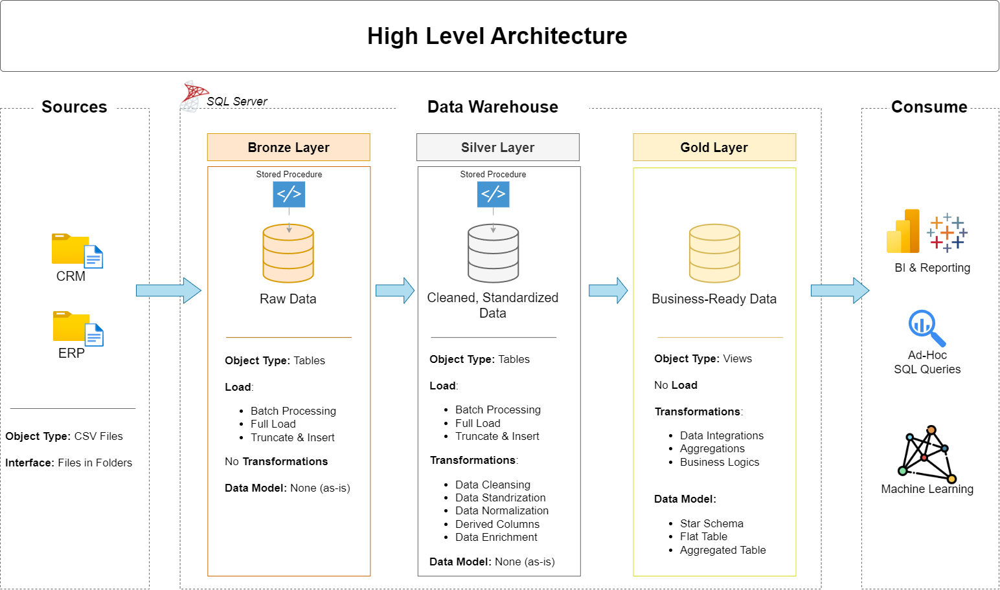
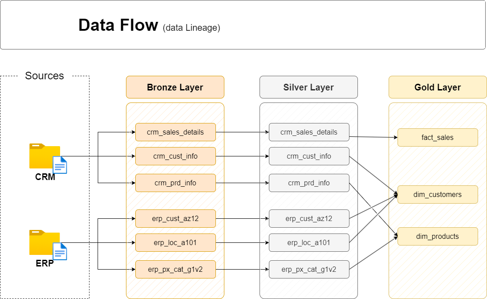
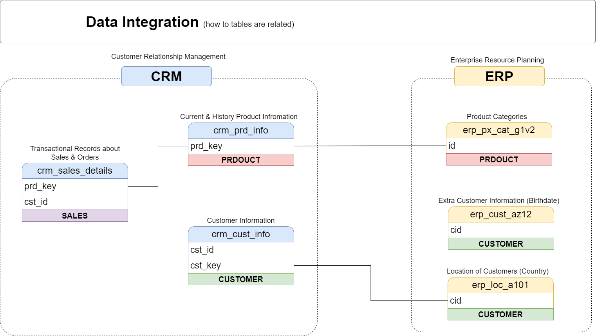
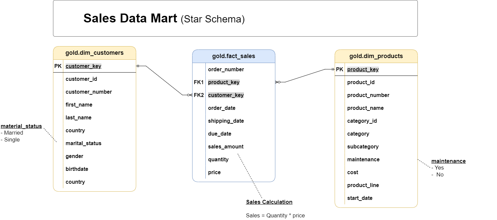
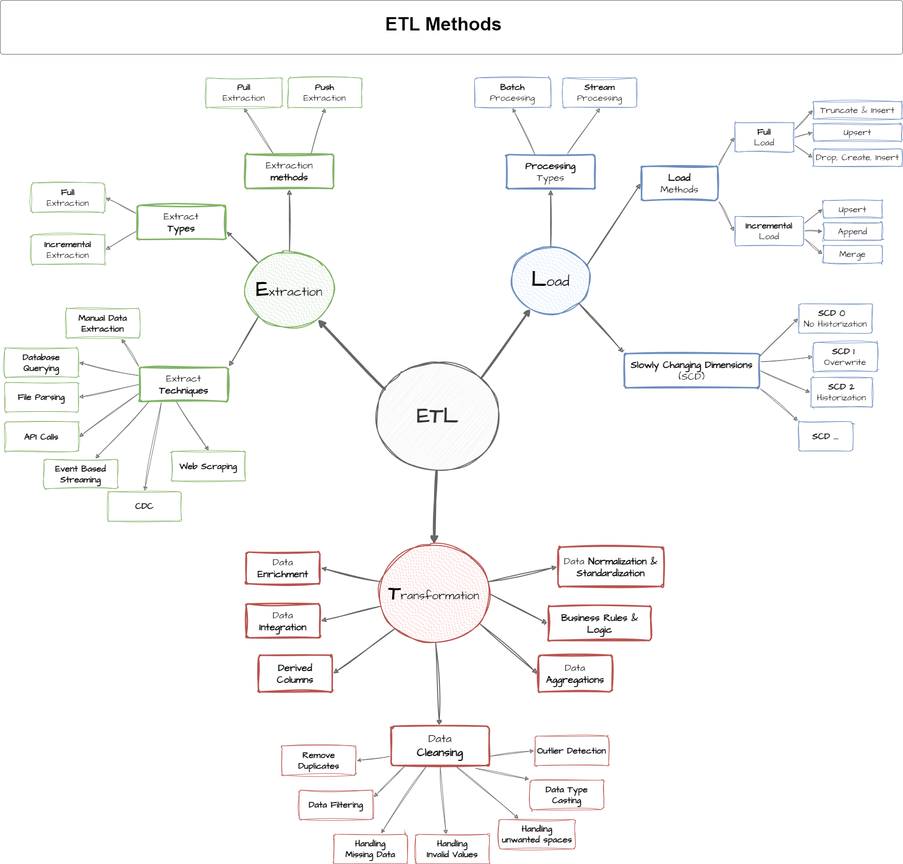

# SQL Data Warehouse & Analytics Engineering Project


-blueviolet?style=for-the-badge)
-success?style=for-the-badge)


An enterprise-grade modern Data Warehouse and ETL solution built on Microsoft SQL Server. This project extracts, cleanses, and transforms raw ERP and CRM data across a **Medallion Architecture (Bronze ➔ Silver ➔ Gold)**, modeling it into a high-performance **Star Schema** optimized for analytical reporting and business intelligence.

---

## 📑 Table of Contents
1. [Repository Structure](#-repository-structure)
2. [Data Architecture](#-data-architecture)
3. [Data Flow & Lineage](#-data-flow--lineage)
4. [Data Integration & Entity Relationships](#-data-integration--entity-relationships)
5. [Data Modeling (Star Schema)](#-data-modeling-star-schema)
6. [ETL Architecture & Stored Procedures](#-etl-architecture--stored-procedures)
7. [Data Quality & Testing](#-data-quality--testing)
8. [Setup & Execution Guide](#-setup--execution-guide)
9. [Project Requirements & Documentation](#-project-requirements--documentation)
10. [License & Author](#-license--author)

---

## 📂 Repository Structure

```
SQL-Data-Warehouse/
├── 00_setup/
│   ├── SETUP GUIDE - read me first.pdf    # Comprehensive setup guide (Windows & Mac)
│   └── mac-docker/
│       ├── docker-compose.yml             # Single-command SQL Server deployment for macOS
│       └── start.command                  # Automated launch script for Docker
├── 01_datasets/
│   ├── source_crm/                        # CRM extracts (cust_info, prd_info, sales_details)
│   └── source_erp/                        # ERP extracts (CUST_AZ12, LOC_A101, PX_CAT_G1V2)
├── 02_docs/
│   ├── data_architecture.drawio          # Editable Draw.io architecture source file
│   ├── data_architecture.png             # Medallion data architecture diagram
│   ├── data_flow.png                     # End-to-end data lineage diagram
│   ├── data_integration.png              # CRM & ERP entity relationship diagram
│   ├── data_model.png                    # Gold layer Star Schema data model
│   ├── ETL.png                           # Comprehensive ETL methods & strategy mindmap
│   ├── data_catalog.md                   # Full data dictionary for Gold facts and dimensions
│   ├── naming_conventions.md             # Standards for schemas, tables, and column naming
│   ├── requirements.md                   # Business and analytical requirements
│   ├── Project_Requirements.pdf          # One-page executive requirements sheet
│   └── data_layers.pdf                   # Theoretical breakdown of warehouse layers
├── 03_scripts/
│   ├── init_database.sql                 # Database and schema initialization (Bronze, Silver, Gold)
│   ├── bronze/
│   │   ├── ddl_bronze.sql                # Table definitions for Bronze layer
│   │   └── proc_load_bronze.sql          # Stored procedure: Bulk load raw CSV files
│   ├── silver/
│   │   ├── ddl_silver.sql                # Table definitions for Silver layer
│   │   └── proc_load_silver.sql          # Stored procedure: Cleanse, standardize, & enrich
│   └── gold/
│       └── ddl_gold.sql                  # Star Schema analytical views (dims & fact)
├── 04_tests/
│   ├── quality_checks_silver.sql         # Quality validation test scripts for Silver layer
│   └── quality_checks_gold.sql           # Referential integrity & uniqueness tests for Gold
├── .gitignore
├── LICENSE
└── README.md
```

---

## 🏗️ Data Architecture

The architecture implements the modern **Medallion Architecture**, separating data processing into three distinct stages:



> 💡 **Architecture Design File:** You can view or customize the architecture diagram directly in [draw.io](https://app.diagrams.net/) using the source file: [`02_docs/data_architecture.drawio`](02_docs/data_architecture.drawio).

### Layer Breakdown:
1. **Bronze Layer (Raw Ingestion):**
   - Stores raw data exactly as received from source systems (CSV flat files).
   - Ingested using automated high-speed `BULK INSERT` operations via stored procedures.
   - Truncate-and-load pattern ensures idempotency without schema mutation.
2. **Silver Layer (Cleansing & Standardization):**
   - Applies data quality transformations, data type casting, and string trimming.
   - Cleanses missing values, normalizes gender (`Male`, `Female`, `n/a`) and marital status (`Married`, `Single`).
   - Resolves cross-source discrepancies between CRM and ERP systems.
3. **Gold Layer (Analytics & Dimensional Modeling):**
   - Implements a Kimball-style **Star Schema** with dimension and fact views.
   - Produces clean, enriched, surrogate-keyed business data ready for BI dashboards and reporting.

---

## 🔄 Data Flow & Lineage

The data pipeline connects source operational systems through progressive transformations to analytical models:



- **Source CRM:** Supplies customer demographics (`cust_info`), product catalogs (`prd_info`), and transactional sales history (`sales_details`).
- **Source ERP:** Supplies demographic fallbacks (`CUST_AZ12`), customer geography (`LOC_A101`), and product subcategories (`PX_CAT_G1V2`).
- **Target Gold Models:**
  - `gold.dim_customers`: Consolidated 360-degree customer profile.
  - `gold.dim_products`: Unified product master with hierarchy and pricing.
  - `gold.fact_sales`: Line-item transactional sales joined to dimensions via surrogate keys.

---

## 🔗 Data Integration & Entity Relationships

Combining multiple source systems requires handling schema differences, missing attributes, and conflicting customer identifiers:



- **Customer Integration:** The CRM system serves as the primary source for customer profile and marital status. ERP data (`CUST_AZ12` and `LOC_A101`) supplies geographic location (Country) and demographic fallback data (Birthdate, Gender).
- **Product Integration:** CRM product codes link directly to ERP category definitions (`PX_CAT_G1V2`) to map granular product types, product lines, and subcategories.

---

## 📊 Data Modeling (Star Schema)

The Gold layer is modeled into a Star Schema optimized for ad-hoc analytical queries and reporting engines:



### Gold Entities:
* **`gold.dim_customers`**:
  - `customer_key` (Surrogate Key, INT)
  - `customer_id`, `customer_number`, `first_name`, `last_name`, `country`, `marital_status`, `gender`, `birthdate`, `create_date`
* **`gold.dim_products`**:
  - `product_key` (Surrogate Key, INT)
  - `product_id`, `product_number`, `product_name`, `category_id`, `category`, `subcategory`, `maintenance_required`, `cost`, `product_line`, `start_date`
* **`gold.fact_sales`**:
  - `order_number` (Degenerate Dimension, NVARCHAR)
  - `customer_key` (FK to `dim_customers`)
  - `product_key` (FK to `dim_products`)
  - `order_date`, `shipping_date`, `due_date`, `sales_amount`, `quantity`, `price`

For complete attribute descriptions and schemas, see the [Data Catalog](02_docs/data_catalog.md) and [Naming Conventions](02_docs/naming_conventions.md).

---

## ⚙️ ETL Architecture & Stored Procedures

The ETL pipelines are implemented as modular, re-runnable T-SQL stored procedures equipped with error logging, execution timer telemetry, and batch tracking:



* **`bronze.load_bronze`:**
  - Truncates raw bronze tables.
  - Executes `BULK INSERT` from dataset CSV files with batch duration tracking.
  - Wraps execution in `BEGIN TRY...BEGIN CATCH` blocks for robust failure recovery.
* **`silver.load_silver`:**
  - Standardizes invalid string spaces using `TRIM()`.
  - Normalizes code values with deterministic `CASE` statements.
  - Enriches dates and handles surrogate source linkages.
  - Tracks individual table load timings and overall batch execution duration.

---

## 🧪 Data Quality & Testing

Data integrity is validated using automated SQL quality check scripts in [`04_tests/`](04_tests/):

1. **Silver Layer Validations (`quality_checks_silver.sql`):**
   - Detects unwanted spaces in string fields.
   - Identifies null or invalid primary/foreign keys.
   - Validates date chronology (`order_date <= shipping_date`).
   - Checks domain boundaries (e.g., negative quantities, zero pricing).
2. **Gold Layer Validations (`quality_checks_gold.sql`):**
   - Verifies surrogate key uniqueness in `dim_customers` and `dim_products`.
   - Validates referential integrity: ensures all `customer_key` and `product_key` values in `fact_sales` have matching dimension records with zero orphan keys.

---

## 🚀 Setup & Execution Guide

### Prerequisites
* **SQL Server** (Developer Edition, Express, or Docker container)
* **SQL Server Management Studio (SSMS)** or **Azure Data Studio**
* *(Mac Users)* Docker Desktop installed (use [`00_setup/mac-docker/`](00_setup/mac-docker/))

### Step-by-Step Installation

1. **Clone the Repository:**
   ```bash
   git clone https://github.com/toshit2006/SQL-Data-Warehouse.git
   cd SQL-Data-Warehouse
   ```

2. **Database Initialization:**
   Execute [`03_scripts/init_database.sql`](03_scripts/init_database.sql) to create the `DataWarehouse` database and configure the schemas:
   ```sql
   CREATE DATABASE DataWarehouse;
   CREATE SCHEMA bronze;
   CREATE SCHEMA silver;
   CREATE SCHEMA gold;
   ```

3. **Bronze Layer Setup & Ingestion:**
   - Execute [`03_scripts/bronze/ddl_bronze.sql`](03_scripts/bronze/ddl_bronze.sql) to build raw landing tables.
   - Review and configure the file paths in [`03_scripts/bronze/proc_load_bronze.sql`](03_scripts/bronze/proc_load_bronze.sql) to point to your local `01_datasets/` path.
   - Execute the bronze load procedure:
     ```sql
     EXEC bronze.load_bronze;
     ```

4. **Silver Layer Transformation:**
   - Execute [`03_scripts/silver/ddl_silver.sql`](03_scripts/silver/ddl_silver.sql) to create clean silver tables.
   - Execute [`03_scripts/silver/proc_load_silver.sql`](03_scripts/silver/proc_load_silver.sql) to run the transformation pipeline:
     ```sql
     EXEC silver.load_silver;
     ```

5. **Gold Layer Modeling:**
   - Execute [`03_scripts/gold/ddl_gold.sql`](03_scripts/gold/ddl_gold.sql) to build the dimensional views (`dim_customers`, `dim_products`, `fact_sales`).

6. **Validate Quality:**
   - Run [`04_tests/quality_checks_silver.sql`](04_tests/quality_checks_silver.sql) and [`04_tests/quality_checks_gold.sql`](04_tests/quality_checks_gold.sql) to confirm all tests pass.

---

## 📋 Project Requirements & Documentation

Detailed project specifications, architecture notes, and data dictionaries are available in [`02_docs/`](02_docs/):
- **[Requirements Document](02_docs/requirements.md)**: Core business rules and analytics objectives.
- **[Executive Requirements PDF](02_docs/Project_Requirements.pdf)**: One-page printable specifications.
- **[Data Catalog](02_docs/data_catalog.md)**: Complete metadata definitions for all gold entities and columns.
- **[Naming Conventions](02_docs/naming_conventions.md)**: Object and field naming guidelines.
- **[Setup Guide PDF](00_setup/SETUP%20GUIDE%20-%20read%20me%20first.pdf)**: Step-by-step SQL Server setup instructions.

---

## 👤 Author & License

Developed by **[Toshit Gupta](https://github.com/toshit2006)**.

This project is licensed under the **[MIT License](LICENSE)** — feel free to use and adapt this project for your own data engineering learning and portfolios.
